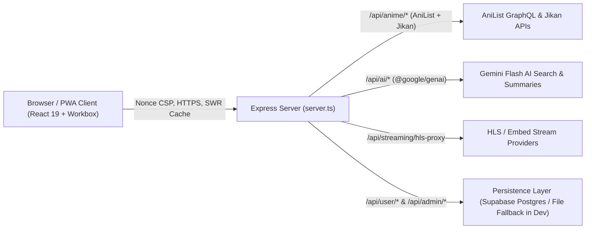

# AniVerve — Cinematic Anime Streaming & Discovery Platform

AniVerve is a full-stack anime discovery, airing calendar, and HLS/embed playback platform built with **React 19**, **Vite 8**, **Tailwind CSS 4**, and **Express + TypeScript**.

## Architecture Overview



### Persistence Strategy

AniVerve uses **Supabase (PostgreSQL)** via `@supabase/supabase-js` (`server/services/db.ts`) as the primary production database for users, sessions, watchlists, favorites, watch history, ratings, admin settings, and audit logs.
- In local development (`NODE_ENV !== 'production'`), if Supabase credentials are absent, `db.ts` transparently falls back to structured JSON storage under `.data/`.
- In production (`NODE_ENV === 'production'`), `.data/` filesystem persistence is strictly blocked, and `server.ts` enforces required secrets (`AUTH_SECRET` and `ADMIN_ACCESS_PASSWORD`) on boot.
- `firestore.rules` is retained only for optional Firebase security-rule auditing in `@firebase/eslint-plugin-security-rules`.

## Key Features

- **Public-First Discovery & Guest Playback**: Home, Explore, Genres, Seasonal, Movies, Popular, Schedule, Anime Details, and Episode Player are open without a login wall. Guest watchlists, favorites, ratings, and watch progress persist in `localStorage` and sync automatically upon sign-in.
- **PWA & Offline Support**: Configured via `vite-plugin-pwa` with precached artwork/catalog runtime caching, install prompt (`PWAInstallButton`), offline indicator (`OfflineIndicator`), and update prompt (`PWAUpdatePrompt`).
- **SEO & Social Sharing**: Per-route canonical URLs, Open Graph/Twitter cards, multi-node JSON-LD (`WebSite` with `SearchAction`, `TVSeries`/`Movie`, `BreadcrumbList`), server-rendered `/anime/:slug` OG tags (`server/services/ogService.ts`), paginated `/sitemap.xml` index, and strict `/robots.txt`.
- **Gemini AI Discovery**: Natural-language search (`⌘/Ctrl+K` → Ask AI), mood matching on Home, and spoiler-free episode/series summaries (`/api/ai/*`).
- **Accessibility (WCAG 2.2 AA)**: Skip-to-content link, single `<main>` and `<h1>` per route, focus-trapped modals/drawers, manual hero carousel pause control, `prefers-reduced-motion` support, and `>= 44px` mobile touch targets.
- **Security Hardening**: Per-request CSP nonces without `unsafe-eval`, HSTS/COOP/CORP headers, strict `APP_URL` CORS allowlist, double-submit CSRF tokens, Zod request validation, login lockout, shared rate limiting, and sandboxed third-party iframes.

## Environment Variables

| Variable | Required in Prod | Description |
| --- | --- | --- |
| `APP_URL` | Recommended | Canonical origin allowlisted by CORS and sitemaps |
| `AUTH_SECRET` | **Yes** | Secret for signing user & CSRF tokens (server refuses prod boot if missing) |
| `ADMIN_ACCESS_PASSWORD` | **Yes** | Admin console access secret (server refuses prod boot if missing) |
| `SUPABASE_URL` | Recommended | Supabase project URL for Postgres persistence |
| `SUPABASE_SERVICE_ROLE_KEY` | Recommended | Server-side Supabase service role key (never exposed to browser) |
| `GEMINI_API_KEY` | Optional | Server-side key for `@google/genai` AI search & summary routes |

### API Key Allowlisting Checklist

- Keep `GEMINI_API_KEY`, `SUPABASE_SERVICE_ROLE_KEY`, `AUTH_SECRET`, and `ADMIN_ACCESS_PASSWORD` strictly in server-side environment variables.
- If using any client-side browser keys, restrict them by HTTP referrer to your production origin(s) in Cloud Console.

## Scripts

```bash
npm run dev          # Start Express + Vite dev server on port 3000
npm run lint         # Run ESLint + strict TypeScript type check (tsc --noEmit)
npm run test:unit    # Run Vitest + React Testing Library frontend tests
npm run test:server  # Run Node/tsx server API, security & hooks AST tests
npm run test:e2e     # Run Playwright smoke tests
npm run build        # Build production client bundle & PWA service worker
```
